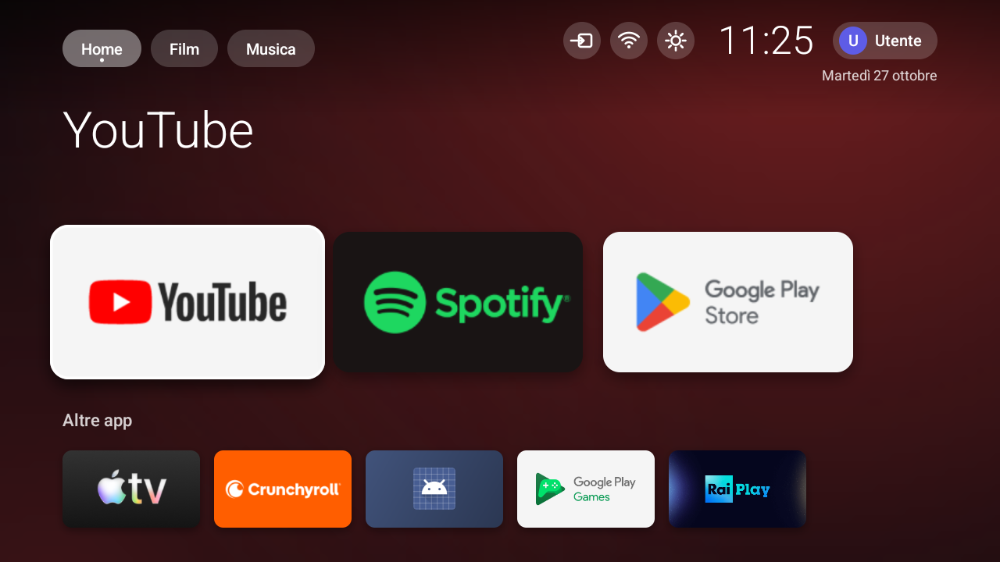
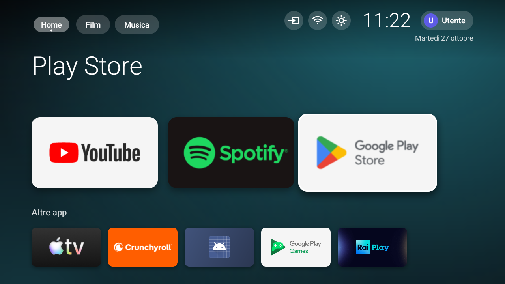
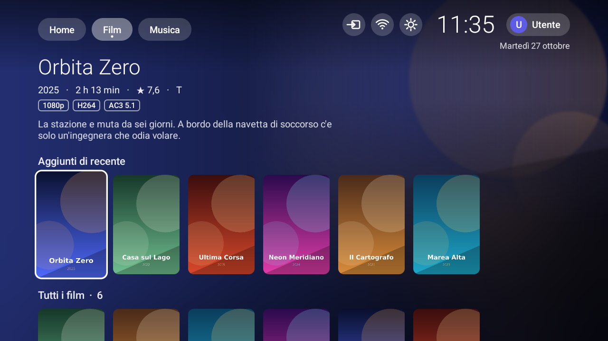
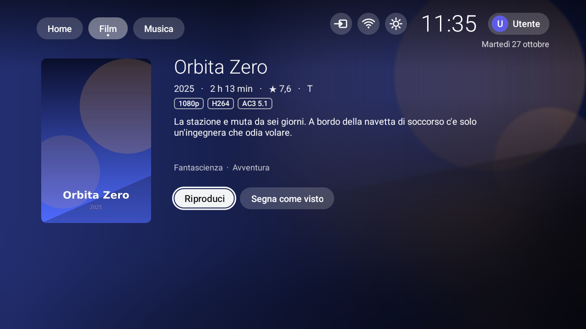
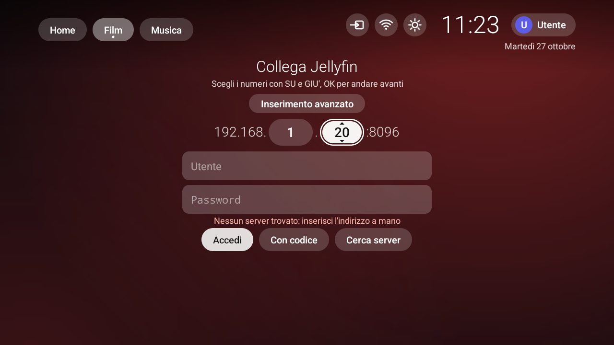
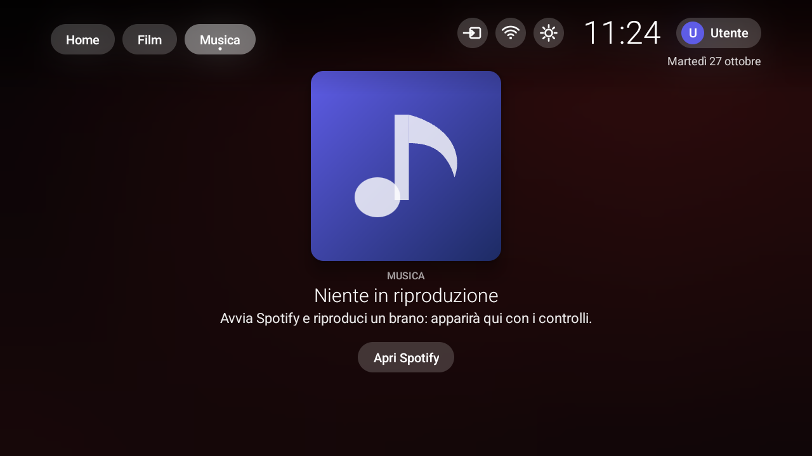

# SimpleTVHome

Una schermata Home alternativa per Android TV, pensata per le TV economiche con Android 9 e un launcher di fabbrica pieno di pubblicità e raccomandazioni. Ha tre sezioni: **Home** con le tue app, **Film** (client per un server [Jellyfin](https://jellyfin.org)) e **Musica** (cosa stai ascoltando, con i controlli). Si usa tutto con il telecomando.

Niente account da creare, niente tracciamento: le uniche connessioni di rete sono quelle verso il tuo server Jellyfin.



## Cosa fa

**Home.** Le app della TV in righe di card. Lo sfondo prende il colore dell'app che hai a fuoco. Con OK lunga su una card si apre un menu: aggiungi o togli dai preferiti, sposta, nascondi, info app. In alto trovi gli ingressi TV, la rete, le impostazioni, l'orologio e il profilo (immagine e nome a scelta; se concedi il permesso sugli account usa quello del tuo account Google).



**Film.** Si collega al tuo server Jellyfin e mostra la libreria con "Continua a guardare", "Guardati di recente", "Aggiunti di recente" e "Tutti i film". La scheda del film ha trama, formato, scelta di audio e sottotitoli, "Riprendi da…" e "Segna come visto". Il lettore è integrato e salva la posizione sul server.




**Accesso al server.** Si può inserire l'indirizzo in due modi. Nel modo *semplice* `192.168.` e la porta `8096` sono già scritti: si scelgono solo gli ultimi due numeri con SU e GIÙ (tenendo premuto vanno più veloci, i tasti numerici li scrivono) e OK per andare avanti. Il modo *avanzato* è un campo di testo per qualsiasi indirizzo. In alternativa puoi usare **Cerca server** (trova Jellyfin sulla rete) o **Con codice** (Quick Connect, lo approvi da telefono).



**Musica.** La libreria musicale del tuo server Jellyfin (lo stesso accesso della sezione Film) in righe: **Brani del giorno** (sei brani scelti a caso, gli stessi per tutta la giornata), **Ascoltati di recente**, **Album** e **Artisti**. Album e artisti aprono una scheda con l'elenco dei brani, *Riproduci* e *Casuale*. I brani suonano nel launcher: in alto trovi copertina, controlli, formato e qualità (per esempio `FLAC · 16 bit · 44,1 kHz`); il pulsante *i* apre tutte le informazioni sul brano (bitrate, frequenza, canali, dimensione, se il server lo sta convertendo, genere, ascolti). I tasti multimediali del telecomando funzionano anche fuori dal launcher. Se suona un'altra app che lo comunica ad Android (per esempio Spotify), in alto vedi quella; per questo serve l'accesso alle notifiche (vedi sotto).



**Accessibilità.** Ogni pulsante ha un'etichetta per il lettore di schermo (TalkBack), il testo segue la dimensione scelta nel sistema e il focus si vede anche senza colore.

## Requisiti

- Una TV (o box) con **Android 7.0 o successivo**. Provato su un televisore Android 9 e sugli emulatori Android TV.
- Un computer con [`adb`](https://developer.android.com/tools/adb) (parte delle *platform-tools* di Android) sulla stessa rete della TV.
- Per le sezioni Film e Musica, un server Jellyfin raggiungibile dalla TV (porta `8096`).

## Installare la release

Scarica `SimpleTVHome-<versione>.apk` dalla sezione **Releases** di questo repository.

### 1. Attiva il debug sulla TV

1. Impostazioni › Info (o *Preferenze dispositivo › Informazioni*) e tocca 7 volte **Build** (o *Numero build*) finché compare "Sei uno sviluppatore".
2. Impostazioni › Opzioni sviluppatore: attiva **Debug USB** e, se c'è, **Debug ADB / Debug di rete**.
3. Annota l'indirizzo IP della TV (Impostazioni › Rete).

### 2. Collegati e installa

```sh
adb connect 192.168.1.20:5555        # l'IP della tua TV
adb install -r SimpleTVHome-0.3.apk
```

Alla prima connessione la TV chiede di autorizzare il computer: scegli *Consenti sempre*.

Per aggiornare, ripeti `adb install -r` con il nuovo file. L'APK deve essere firmato con la stessa chiave di quello già installato; se `adb` risponde `INSTALL_FAILED_UPDATE_INCOMPATIBLE`, disinstalla prima con `adb uninstall dev.drift.homelauncher`.

### 3. Concedi i permessi (facoltativo)

```sh
# nome e account del profilo
adb shell pm grant dev.drift.homelauncher android.permission.GET_ACCOUNTS
# sezione Musica: brano in riproduzione nelle altre app (Spotify...)
adb shell cmd notification allow_listener dev.drift.homelauncher/dev.drift.homelauncher.MediaListener
```

Senza questi due comandi tutto il resto funziona: il profilo si chiama "Utente" e la sezione Musica mostra solo la tua libreria Jellyfin (e ti chiede il permesso per vedere le altre app).

## Usarlo al posto della Home di fabbrica

Il launcher si installa come una normale app e si apre dall'elenco app. Per farlo partire con il tasto **Home** del telecomando, sceglilo come Home predefinita. Prima di cominciare puoi vedere cosa risponde oggi la TV:

```sh
adb shell cmd package resolve-activity --brief -a android.intent.action.MAIN -c android.intent.category.HOME
```

### Metodo 1: dalla TV

Premi **Home**. Se la TV mostra "Scegli app Home", seleziona *Home* e poi **Sempre**. Molte TV non mostrano questa scelta: passa al metodo 2.

### Metodo 2: con adb (consigliato, resta dopo i riavvii)

```sh
adb shell cmd package set-home-activity dev.drift.homelauncher/.HomeActivity
```

Per tornare indietro, indica il launcher di fabbrica (quello che ti ha risposto `resolve-activity`, per esempio):

```sh
adb shell cmd package set-home-activity com.google.android.tvlauncher/.MainActivity
```

### Metodo 3: disattivare il launcher di fabbrica

Se dopo un riavvio o una pressione di Home la TV riapre comunque il launcher originale, puoi disattivarlo (senza disinstallarlo). Fallo **dopo** aver verificato che SimpleTVHome si apre e funziona, e tieni a portata di mano `adb`: senza nessuna Home attiva la TV non ha una schermata iniziale.

```sh
adb shell pm disable-user --user 0 com.google.android.tvlauncher   # il nome del pacchetto cambia da TV a TV
```

Per riattivarlo:

```sh
adb shell pm enable com.google.android.tvlauncher
```

Il nome del pacchetto del launcher di fabbrica si legge con il comando `resolve-activity` qui sopra: è la parte prima della `/`. I produttori possono usare un pacchetto proprio (per esempio quello del marchio della TV).

## Compilare da sorgente

Non serve Gradle. Servono le *build-tools* e una piattaforma Android del SDK, e un JDK.

```sh
./build.sh      # crea build/home.apk, firmato con una chiave di debug generata al primo uso
```

Lo script usa `aapt2`, `javac`, `d8`, `zipalign` e `apksigner`. Per un SDK in un'altra cartella imposta `ANDROID_SDK_ROOT`, e `JAVAC` per un altro JDK; le versioni delle build-tools e della piattaforma sono scritte in cima a `build.sh`.

## Note

- Il launcher non è un'app dello store e usa una chiave di firma di debug: installalo solo da fonti di cui ti fidi.
- Le immagini in `docs/screenshots` vengono da un emulatore Android TV con un server Jellyfin di prova.
